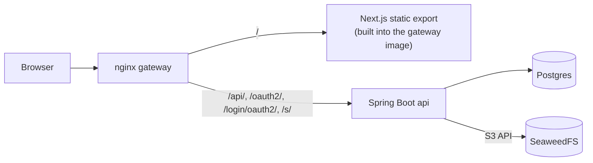

# DiscoSticker.cafe

Upload an image and get an unguessable link that shows up sticker-sized when you paste it in Discord.

Live at **https://discosticker.cafe**

<!-- screenshot: docs/images/discord-paste.png -->

## What it does

1. **Sign in with Discord.** Accounts less than 7 days old can't sign in.
2. **Upload a PNG or JPEG**, up to 10 MB, with up to 20 uploads per hour.
3. **Paste the link in Discord.** It shows at sticker size. Images larger than 160 × 160 px are shrunk to fit; smaller ones keep their size, so images are only ever shrunk.

Every upload is checked, re-encoded as a new PNG, and served from `https://discosticker.cafe/s/<id>.png`. The original file is never stored.

## Architecture



The browser talks only to nginx, which serves one origin, so there's no CORS configuration. Postgres and SeaweedFS are reachable only on the internal Docker network.

**Stack**

- **Gateway:** nginx 1.30.5 (Alpine).
- **Frontend:** Next.js 16.4.0 as a static export, with React 19.3.0 and TypeScript ~5.9.3. It's built with Node 24 inside the gateway image.
- **api:** Spring Boot 4.1.1 with Spring Security on Java 25 (Eclipse Temurin), plus Flyway and the AWS SDK for Java v2 S3 client (BOM 2.55.14).
- **Database:** Postgres 18.6 (Alpine).
- **Object storage:** SeaweedFS 4.48, used only through its S3 API, so moving to AWS S3 is a configuration change.
- **Runtime:** docker compose, locally and in production.

## Security highlights

- **Sign-in:** Discord OAuth with PKCE (S256). The ban and account-age checks run before any session exists. ([discord-login spec](openspec/specs/discord-login/spec.md), [decisions](docs/decisions.md))
- **Deny by default:** signed-out calls to anything except health, sticker images and the login endpoints get 401 JSON. The CSRF token is read only from the `X-XSRF-TOKEN` header. ([discord-login spec](openspec/specs/discord-login/spec.md), [sticker-upload spec](openspec/specs/sticker-upload/spec.md))
- **Uploads:**
  - the type is detected from content (magic bytes);
  - dimensions are capped from the header (8,192 px a side, 32 MP) before decoding;
  - every image is re-encoded to a PNG with no metadata;
  - temp files live only on memory-backed storage;
  - at most 2 images decode at once.

  ([sticker-upload spec](openspec/specs/sticker-upload/spec.md))
- **Per-user limits:** the hourly limit is checked under a database row lock, so parallel uploads can't race past it, and bans are re-checked on every upload. ([sticker-upload spec](openspec/specs/sticker-upload/spec.md))
- **Links:** sticker IDs are 128-bit random values. Stickers are served without cookies, through the api, from a private bucket. ([sticker-upload spec](openspec/specs/sticker-upload/spec.md), [object-storage spec](openspec/specs/object-storage/spec.md))
- **Headers:** HSTS, `nosniff`, `Referrer-Policy` and `X-Frame-Options` come only from nginx; the api's own copies are hidden. ([gateway-routing spec](openspec/specs/gateway-routing/spec.md))
- **Secrets:** they live only in a gitignored `secrets.env`. In production they're created on the server, and Claude Code never reads or handles them. ([secrets-handling spec](openspec/specs/secrets-handling/spec.md), [decisions](docs/decisions.md))

## How it was built

Every change went through [OpenSpec](openspec/specs/) (explore → propose → apply → archive), driven through Claude Code. A PM chat and a dev chat reviewed each step.

- Each change has a proposal (with its out-of-scope list and security impact), spec deltas, a design that lists the threats considered, and tasks.
- Every task ends in a `Verify:` command: a test, a type check, or a command against the running stack.
- Decisions are approved in the PM chat before they go in [docs/decisions.md](docs/decisions.md), which records 115 so far, each with its reason.
- Finished changes are archived in [openspec/changes/archive/](openspec/changes/archive/), and their specs are merged into [openspec/specs/](openspec/specs/).

**What the process caught**

- **A stale `origin/master` on the server** checked out pre-deploy files and silently broke the gateway's config mount. Server checkouts are now compared with GitHub's hash, and the gateway is recreated after a branch switch. ([decisions](docs/decisions.md))
- **A doubled paste of a production secret** was caught during the login deploy by checking its length without printing it. ([decisions](docs/decisions.md))
- **Spring Security's default one-year HSTS** would have overridden nginx's short `max-age=300`. The api's security headers are hidden, so nginx is their only source. ([decisions](docs/decisions.md))
- **Exploration had concluded that Discord login would run without PKCE.** The local stack showed in task 5.5 that Spring Security sends PKCE anyway, and the first real login confirmed Discord accepts it. ([login design](openspec/changes/archive/2026-10-11-add-discord-login/design.md))

## Run it locally

You need Docker Desktop, running. For sign-in, you also need a Discord application whose only redirect URI is `http://localhost:8080/login/oauth2/code/discord`.

From the repo root, in Windows PowerShell:

```powershell
# 1. Create secrets.env (gitignored) and replace every placeholder value.
Copy-Item secrets.env.example secrets.env
notepad secrets.env

# 2. Build and start the stack, waiting until every service is healthy.
docker compose --env-file secrets.env up --build -d --wait --wait-timeout 300

# 3. Check health through the gateway; expect "status":"UP".
curl.exe -fsS http://localhost:8080/api/health

# 4. Stop.
docker compose --env-file secrets.env down
```

- **Discord app:** `DISCORD_CLIENT_SECRET` in `secrets.env` is your Discord application's client secret. Its client ID is public and set as `DISCORD_CLIENT_ID` in [compose.yaml](compose.yaml); change it there if you use your own application.
- **The URL:** browse to http://localhost:8080 exactly. The redirect URI is built from the address in the browser, and Discord accepts only the registered one.
- **Checking the compose file:** use `docker compose --env-file secrets.env.example config --quiet`. Never run `config` with `secrets.env`, because it prints the values.

**Tests**

```powershell
# api unit and integration tests (Testcontainers; Docker must be running)
cd api; .\mvnw.cmd -B verify; cd ..

# frontend type check and static export
cd frontend; npm ci; npm run typecheck; npm run build; cd ..
```

## Deploy

Production runs the same compose stack plus [compose.prod.yaml](compose.prod.yaml) on one server; the runbook is [docs/deploy.md](docs/deploy.md).

## Known limits and next steps

Known limits:

- **No delete button yet.** Takedowns are a manual runbook procedure, and a removed sticker can stay in browser and Discord caches for up to a day.
- **Sessions are in memory,** so a redeploy or restart signs everyone out.
- **HSTS is still short** (`max-age=300`), and there's no Content-Security-Policy yet.
- **Bans** are set by hand in the database, with no admin UI.
- **Only accepted uploads count** toward the hourly limit; failed attempts are audited but not capped.
- **Visitor IP addresses** aren't stored in audit records. nginx's access log still has them, and container logs aren't rotated yet.
- **Images:**
  - embedded color profiles are ignored, so Display P3 photos come out slightly duller;
  - photos over 8,192 px a side or 32 MP are rejected;
  - animated PNGs become a still image.
- **There's no monitoring** yet.

Next steps, from the decision log:
- GIF and WebP uploads;
- a "My stickers" page with owner-only delete;
- admin ban-and-purge, and a report link;
- importing server stickers;
- Postgres-backed sessions;
- a longer HSTS max-age, and a Content-Security-Policy;
- visitor IPs in audit records, with retention and log rotation;
- a frontend test runner;
- a cap on failed upload attempts.

## License

MIT. See [LICENSE](LICENSE).
